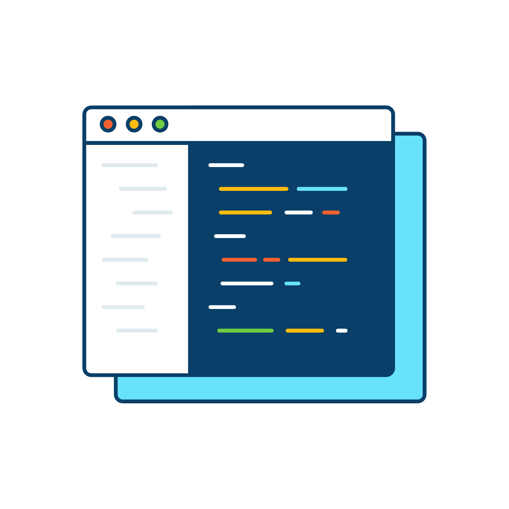

Meu nome é Gabriel Rocha Lopes, tenho 24 anos e sou apaixonado por tecnologia e academia.  Em 2022 tive meu primeiro contato com programação e me apaixonei pela área, desde então procuro me dedicar aos estudos e a prática para me tornar um grande desenvolvedor.   Atualmente sou estágiario na Bwtech, atuando como desenvolvedor de software, curso Sistemas de Informação na PUC Minas e estou conduzindo monitoria de desenvolvimento web na mesma.

  
🦄 Principais tecnologias:

    

      
      
      
       
      
           
      
           
      
       
    

